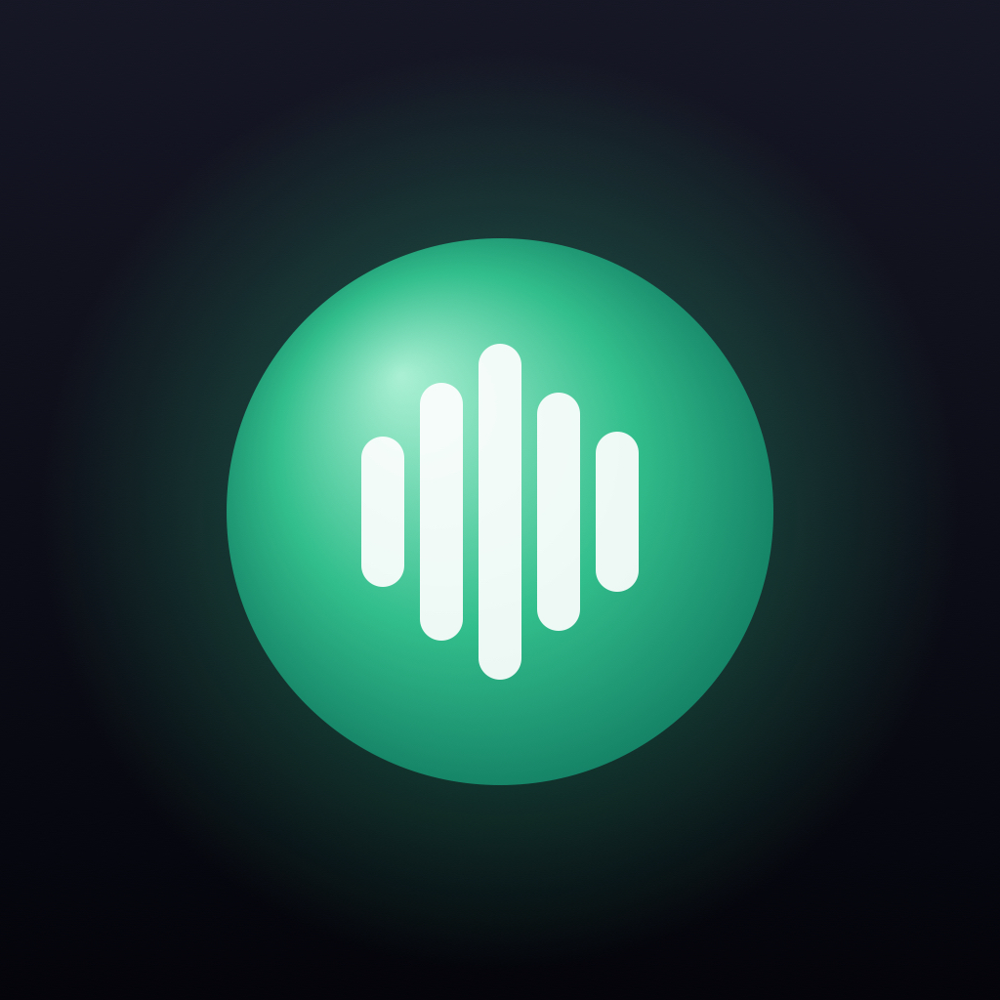

<p align="center">
  
</p>

<h1 align="center">Hollr</h1>

<p align="center">
  <b>Your coding agents on a remote server – from your iPhone, Mac or Linux desktop.</b><br>
  Talk to <code>omp /live</code>, follow and steer omp, Claude Code and Codex sessions in <a href="https://herdr.dev">herdr</a>,<br>
  browse git and files – over plain SSH, with no relay, no VPN and no extra service.
</p>

---

## What it does

- **Live voice with omp.** `omp /live` needs a microphone and speakers, so it normally doesn't work on a server.
  Hollr gives the server a virtual microphone and speaker per session and streams both over SSH to your phone or desktop.
  You talk, omp works on the server, you hear the answer.
- **Sessions like in the terminal.** All herdr sessions (omp, Claude Code, Codex, plain terminals) grouped by machine.
  omp chats are rendered like omp's TUI: tool cards, diffs, TODO tree, background jobs, status line.
- **Start and steer.** New sessions with model and thinking/effort level, switch models in running sessions,
  send prompts and keys, answer agent questions, open terminals in your home directory.
- **Git and files.** Uncommitted changes with full-context diffs, stage/unstage, history graph, branches with PR checks, file browser.
- **Spaces.** herdr workspaces grouped by repo and worktree – create worktrees, close them, delete the branch (also on origin).
- **Push notifications** when an agent waits for you, finishes or fails – sent from your own server straight to Apple.
- **On-device dictation** (iPhone) with Parakeet, Whisper or Apple – multilingual, with your technical vocabulary.
- **Server tools.** Server info (load, processes, setup checks), install/update herdr, omp, Claude Code, Codex and Hollr from the app,
  a browser that opens `localhost:3000` on the server through the SSH connection.

German and English, light and dark themes, Face ID lock, zen mode.

## How it works

```
iPhone / Mac / Linux ──SSH (your key, pinned host key)──▶ server: hollr gate ──▶ herdr · omp · git
                                                                     └──▶ virtual mic/speaker (PulseAudio) ◀── omp /live
```

There is no Hollr service to run. Paired devices get an SSH key that may only run `hollr gate` (a forced command)
and open TCP connections to the server's own `localhost` – no shell, no other hosts.
Everything else – reading sessions, sending prompts, git, live audio – is a `hollr gate` command over that connection.

## Set up a server

As the user that runs herdr and omp:

```bash
curl -fsSL https://raw.githubusercontent.com/sensedrive/hollr/main/install.sh | bash
```

The installer only adds what's missing and is safe to re-run (that's the update). It sets up PulseAudio (apt, dnf, yum, pacman,
zypper or apk), herdr, omp, the `hollr` binary, a herdr plugin and a small watcher service for push notifications.
Linux x64/arm64 and macOS arm64 are supported.

Then:

```bash
omp            # once: /login → OpenAI Codex (ChatGPT) – needed for /live
hollr pair     # shows a QR code; scan it with the iPhone camera or in Hollr
```

For the Mac and desktop apps use `hollr pair --link` and paste the link.

| Command | |
|---|---|
| `hollr pair [--name L] [--host ADDR] [--port N] [--link]` | pair a device (QR code valid 10 minutes, single use) |
| `hollr devices` / `hollr revoke <id\|name>` | list / remove paired devices |
| `hollr doctor` | check the setup, with fixes |
| `hollr push status\|test` | push notifications (the key is imported once in the iPhone app) |

`--host` is for servers behind NAT or reached by a DNS name.

## Apps

| | |
|---|---|
| **iPhone** | `ios/` – SwiftUI, SSH via [Citadel](https://github.com/orlandos-nl/Citadel). Build with your own team (see below). |
| **Mac** | Same app via Mac Catalyst. DMGs for Apple Silicon and Intel are attached to every [release](https://github.com/sensedrive/hollr/releases). |
| **Linux** | `desktop/` – Tauri (Rust + Svelte): sessions, chat, git, live voice. `.deb`, `.rpm` and AppImage for x64 and arm64 on every release. |

Release builds without a Developer ID are ad-hoc signed: on the Mac, open the app the first time with right-click → Open.

## Security

- Pairing codes are single-use and expire after 10 minutes. The device key is created on the device and never leaves it.
- The server's host key fingerprint is part of the pairing code and pinned; a different key aborts the connection.
- Device keys are restricted in `authorized_keys`: `restrict,port-forwarding,permitopen="localhost:*",…,command="hollr gate"`.
- Secrets in agent output (tokens, keys) are redacted before they leave the server.
- Folder deletion from the app only works inside your home directory or `/tmp`, never for repos with linked worktrees.

## Development

```bash
git config core.hooksPath .githooks     # run the CI checks locally before every push

# server (Bun + TypeScript, compiled to a single binary)
cd server && bun install && bun test && bun run check-types && bun run lint
bun run build linux-x64

# iPhone / Mac app
cd ios && cp Config/Local.example.xcconfig Config/Local.xcconfig   # your team ID
xcodegen generate && open Hollr.xcodeproj
./scripts/mac-dmg.sh                     # Mac DMG (notarized with a Developer ID, ad-hoc otherwise)

# desktop (Linux, also builds on macOS/Windows)
cd desktop && bun install && bun run tauri dev
```

Protocol: frames `[type u8][length u24][payload]` – `0x01` PCM s16le 24 kHz mono, `0x02` JSON
([`server/src/frames.ts`](server/src/frames.ts)). Releases: `git tag vX.Y.Z && git push --tags` – CI builds the server binaries,
the Mac DMGs and the Linux packages and attaches them to the release.

| Path | |
|---|---|
| `server/` | `hollr` CLI and gate: herdr, sessions, timeline, git, live audio, push watcher |
| `ios/` | iPhone and Mac app |
| `desktop/` | Linux desktop app (Tauri) |
| `plugin/` | herdr plugin |
| `install.sh` | server installer |

## License

[MIT](LICENSE)
